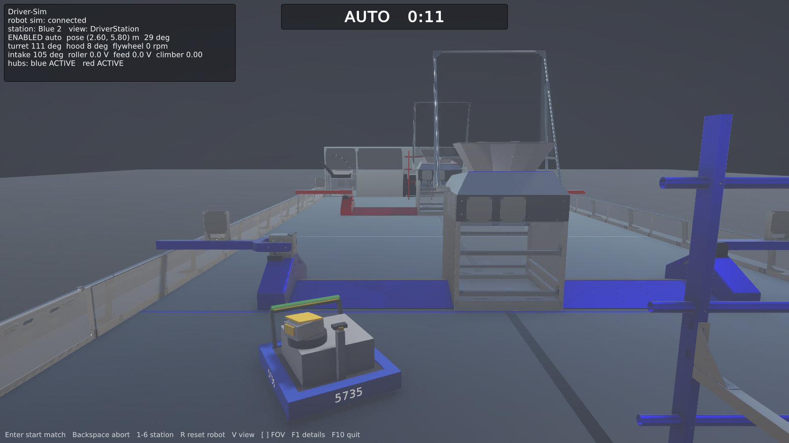

# Driver-Sim

A video-game-style driver trainer for FRC 5735's 2026 robot (REBUILT). The driver drives the **real robot code** —
same controller, same bindings, same drive tuning — in WPILib simulation, while a Unity game shows the field from the
driver station, simulates fuel and scoring, and runs matches.

```
Xbox controller ─► WPILib sim GUI (Joysticks / DS panels)
                     ▼
  FRC-2026 robot code, unmodified, in WPILib sim
   + Driver-Sim bridge (this repo, sim-only Java)
       • mechanism sim: turret, hood, flywheel, intake, spindex, climber sensors
       • field system: match timing, enable/mode, game message, hub shifts
       • game hooks: robot placement, collision push-outs, flywheel loss per shot
                     │ NetworkTables 4 (/DriverSim/*)
                     ▼
  Unity game (unity/DriverSim): field, fuel, scoring, HUD, driver-station camera
```

The robot code owns robot motion (CTRE's swerve sim), so drive feel matches the real robot. The game owns the world.

## Status

| Phase | What | State |
|---|---|---|
| 1 | Repo, Gradle hook, bridge, mechanism sim, match control, self-test | done |
| 2 | Unity core: NT4 client, field, robot, driver-station camera | done |
| 3 | Collisions: walls, hub, tower, trench, bumps | |
| 4 | Gameplay: fuel, intake, shooting, scoring, HUD | |
| 5 | Packaging: Windows/Linux builds, run scripts | |

## Layout

```
bridge/src/main/java/driversim/      bridge (compiled inside the robot project as the "driverSim" source set)
  DriverSimMain.java                 entry point: builds Robot like frc.robot.Main, attaches the bridge
  DriverSimBridge.java               per-loop glue: mechanisms, commands, DS, publishing
  SelfTest.java                      scripted headless check against the real robot code
  mech/                              mechanism models and device links
  game/                              match controller, NT topics and layouts, command parser
  tools/NtProbe.java                 CLI that connects like the game does
bridge/src/test/java/                unit tests for the pure logic
gradle/driversim.gradle              applied from the robot project's build.gradle
unity/DriverSim/                     Unity 6 (6000.6.8f1) URP project
  Assets/DriverSim/Scripts/          game code: Net/ (NT4 client, protocol), Field/, Robot/, Game/, Util/
  Assets/DriverSim/Editor/           SceneBuilder (scene is generated from code), BuildPlayers
  Assets/ThirdParty/AdvantageScope/  2026 field model (BSD-3, see its LICENSE.txt)
scripts/build-unity.sh               batch-mode build: linux | windows | all | scene
scripts/capture-screenshots.sh       run sim + game, drive with probe commands, save screenshots
docs/screenshots/                    current renders
```

## Setup

1. Check out `Driver-Sim` next to `FRC-2026` (same parent folder). On FRC-2026, use branch `feature/driver-sim`,
   whose `build.gradle` ends with one guarded line:
   `if (file('../Driver-Sim/gradle/driversim.gradle').exists()) { apply from: '../Driver-Sim/gradle/driversim.gradle' }`
2. A JDK 17 (the WPILib 2026 one is fine). Gradle downloads everything else.
3. For the game (phase 2+): Unity Hub + Unity 6 LTS (6000.0.x) with Linux and/or Windows build support.

## Game



Build it with `scripts/build-unity.sh` (Linux; `windows` / `all` for the others) — the project must not be open in
the editor. `./gradlew simulateDriverSim` then starts it automatically. Keys: Enter start match, Backspace abort,
1-6 Blue 1-3 / Red 1-3, R reset robot to its start spot, V driver/overhead view, [ ] field of view, F1 details,
F10 quit. Game arguments (also via `DRIVERSIM_GAME_ARGS`): `--nt-host <host>`, `--view overhead`,
`--screenshot <png> [--screenshot-delay s] [--screenshot-count n] [--screenshot-interval s] [--quit-after-screenshot]`.

The scene is generated by `SceneBuilder` (menu Driver-Sim > Rebuild Scene); change the code, not the scene file.
Unity world = field center origin, X = field x, Z = field y, Y = up (`Field/FieldFrame.cs`).

## Running (from FRC-2026/)

| Command | What it does |
|---|---|
| `./gradlew simulateDriverSim` | Robot code + bridge in WPILib sim with the sim GUI, and starts the Unity game if built. |
| `./gradlew selfTestDriverSim` | Headless scripted check (turret zero, intake, flywheel, hood, climber, driving, shot gating, match). Fails on any step. |
| `./gradlew testDriverSim` | Bridge unit tests. |
| `./gradlew probeDriverSim -Pargs="30,station R1,start"` | While a sim runs: print `/DriverSim` state, send game commands. |

`./gradlew simulateJava` is unchanged and does not include the bridge.

### Controller

In the sim GUI's **System Joysticks** panel, drag your Xbox controller onto **Joystick 0** (the driver port) and
make sure **Map gamepad** is checked for it, so axes and buttons arrive in the same order as on the real driver
station. The sim GUI window has to stay open (it can sit behind the game) to keep reading the controller.

### Matches

Outside a match the bridge leaves the driver station to the sim GUI (free play: enable teleop from the GUI). When the
game sends `start`, the bridge acts as the field system: 20 s autonomous, 3 s disabled, 2:20 teleop, then disabled.
It sets match time and the game-specific message (autonomous winner, which drives the hub shifts). During a match the
bridge re-asserts the enable state every loop, so stop a match from the game (`abort`), not the GUI.

## Protocol (NT4, all under `/DriverSim`)

| Topic | Type | Direction | Contents |
|---|---|---|---|
| `robot/state` | double[] | bridge → game | pose, velocity, mechanisms, enable/mode — `game/RobotStateLayout.java` |
| `match/state` | double[] | bridge → game | phase, match time, hub activity, station, auto winner — `game/MatchStateLayout.java` |
| `bridge/info` | string | bridge → game | protocol version |
| `game/command` | string | game → bridge | `"<seq> <verb> [args]"`: `start`, `abort`, `station R2`, `autoWinner B`, `resetPose x y heading`, `ballLaunched` |
| `game/poseNudge` | double[3] | game → bridge | collision push-out `{dx, dy, dHeading}` (m, rad, field frame), added to the current pose |

Field frame is WPILib's blue-origin frame (x along the field's length from the blue wall, CCW-positive headings).

## Mechanism sim notes

- Each mechanism uses the robot code's own feedforward gains (`kS`, `kV`, `kA`, `kG`) where they exist, so it responds
  the way the code was tuned to expect. Values without robot-code gains (intake/climber `kA`, climber speed, flywheel
  spin-up time constant) are game-feel estimates in `RobotMechanismSim`.
- Devices are reached by CAN ID / DIO / PWM / analog channel from the robot's `Constants`; Phoenix 6 allows a second
  `TalonFX` handle on the same ID. REV's sim needs the SparkFlex instances, taken from the public `robot.spindex`.
- The robot code's `MatchState` caches the autonomous winner once per process, so a second match in the same sim run
  keeps the first match's hub-shift order in the robot code (the bridge's `match/state` hub flags are correct).
