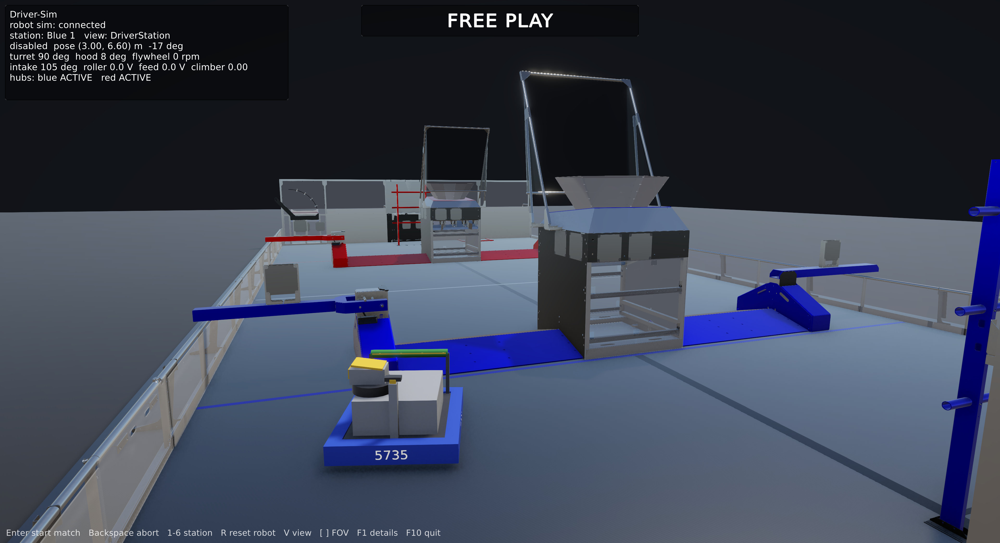

# Fieldrunner

A video-game-style driver trainer for FRC 5735's 2026 robot (REBUILT). The driver drives the **real robot code** —
same controller, same bindings, same drive tuning — in WPILib simulation, while a Unity game shows the field from the
driver station, simulates fuel and scoring, and runs matches.

```
Unity game (unity/DriverSim): menus, controller / keyboard input, field, fuel, scoring, HUD, driver-station camera
   ▲ NetworkTables 4 (/DriverSim/*): robot + match state, rumble        │ virtual Xbox controller, commands, pose corrections
   │                                                                    ▼
  FRC-2026 robot code, unmodified, in WPILib sim
   + Fieldrunner bridge (this repo, sim-only Java) = the driver station
       • driver station: the game's controller becomes joystick port 0; enable, mode, alliance station, pauses
       • mechanism sim: turret, hood, flywheel, intake, spindex, climber sensors
       • field system: match timing, game message, hub shifts
       • game hooks: robot placement, pose corrections from Unity's collisions, flywheel loss per shot
```

The robot code owns robot motion (CTRE's swerve sim), so drive feel matches the real robot. The game owns the world.

## Code style

All code follows the team style guide, [`FRC/STYLE.md`](../FRC/STYLE.md); Java is formatted with
`scripts/format.java.sh` (clang-format with the team's `.clang-format`). See CLAUDE.md for how the rules map to C#.

## Status

| Phase | What | State |
|---|---|---|
| 1 | Repo, Gradle hook, bridge, mechanism sim, match control, self-test | done |
| 2 | Unity core: NT4 client, field, robot, driver-station camera | done |
| 3 | Collisions: walls, hub, tower, trench, bumps | done |
| 3b | Game shell: title, station picker, pause, controls and options screens; controller and keyboard input; the bridge is the driver station (no sim GUI) | done |
| 3c | Controllers screen: choose which device drives (keyboard or one controller) | done |
| 4 | Gameplay: fuel, intake, shooting, scoring, HUD | |
| 5 | Packaging: Windows/Linux builds, run scripts | |

## Layout

```
bridge/src/main/java/driversim/      bridge (compiled inside the robot project as the "driverSim" source set)
  DriverSimMain.java                 entry point: builds Robot like frc.robot.Main, attaches the bridge
  DriverSimBridge.java               per-loop glue: mechanisms, commands, DS, publishing
  SelfTest.java                      scripted headless check against the real robot code
  mech/                              mechanism models and device links
  InputOwner.java                    who supplies joystick input: game, gui or selftest
  game/                              match controller, NT topics and layouts, command parser, joystick link
  tools/NtProbe.java                 CLI that connects like the game does
bridge/src/test/java/                unit tests for the pure logic
gradle/driversim.gradle              applied from the robot project's build.gradle
unity/DriverSim/                     Unity 6 (6000.6.8f1) URP project
  Assets/DriverSim/Scripts/          game code: Net/ (NT4 client, protocol), Field/ (frame, obstacle layout), Robot/ (model, collision), Game/ (flow, input, menus), Util/
  Assets/DriverSim/UI/               menu layout (DriverSim.uxml), style (DriverSim.uss), panel settings
  Assets/DriverSim/Input/            DriverControls.inputactions (generated by DriverControlsBuilder from RobotControlsLayout)
  Assets/DriverSim/Editor/           SceneBuilder (scene is generated from code), DriverControlsBuilder, BuildPlayers
  Assets/ThirdParty/AdvantageScope/  2026 field model (BSD-3, see its LICENSE.txt)
scripts/build-unity.sh               batch-mode build: linux | windows | mac | all | scene
scripts/capture-screenshots.sh       run sim + game, drive with probe commands, save screenshots
docs/screenshots/                    current renders
```

## Setup

1. Clone this repo (https://github.com/team5735/Fieldrunner) as `Fieldrunner` next to `FRC-2026` (same parent folder). On FRC-2026, use branch `feature/driver-sim`,
   whose `build.gradle` ends with one guarded line:
   `if (file('../Fieldrunner/gradle/driversim.gradle').exists()) { apply from: '../Fieldrunner/gradle/driversim.gradle' }`
2. A JDK 17 (the WPILib 2026 one is fine). Gradle downloads everything else.
3. For the game (phase 2+): Unity Hub + Unity 6 LTS (6000.0.x) with Linux, Windows and/or Mac Build Support (Mono).

## Game



More renders, in build order: [docs/screenshots](docs/screenshots/README.md).

`./gradlew simulateDriverSim` opens one window, the game, at a title screen: Start Match or Free Practice (each asks
for a driver station first), Controls, Controllers, Options, Quit. The camera stands behind the selected station and faces the field
center. Esc (or Start then Back on a controller, held half a second) pauses; the pause menu has Resume, Restart Match,
Reset Robot, Controls, Controllers, Options and Quit to Title. Closing the game (Quit, F10 or the window) ends the
`simulateDriverSim` session: the game sends `quit` and the robot sim exits cleanly.

Build it with `scripts/build-unity.sh` (Linux; `windows` / `mac` / `all` for the others) — the project must not be
open in the editor. Any host builds all three; the Mac app is universal (Intel and Apple Silicon). `./gradlew simulateDriverSim` then starts it automatically.

Game hotkeys (kept off the keys the robot uses, since the keyboard is also a robot controller): Esc pause / back,
F1 details panel, F2 obstacle collider overlay, F3 driver / overhead view, F4 / F5 field of view narrower / wider,
F6 reset robot to its start spot, F10 quit. Game arguments (also via `DRIVERSIM_GAME_ARGS`): `--nt-host <host>`,
`--start-in title|practice|match` (default `title`; `practice` and `match` skip the menus), `--station <B1..R3>`,
`--view overhead`, `--show-colliders`, `--screenshot-menu title|station|controls|controllers|options|pause|disconnected|toast`
(opens that screen, for captures), `--collision-selftest` (feeds synthetic poses to the collision code, logs
`[Driver-Sim collision-selftest] PASS|FAIL ...` to the player log and exits 0/1),
`--screenshot <png> [--screenshot-delay s] [--screenshot-count n] [--screenshot-interval s] [--quit-after-screenshot]`.
Arguments override the options saved in `PlayerPrefs`.

### Platforms and GPU

| Platform | Graphics API (first supported wins) | Discrete GPU on hybrid laptops |
|---|---|---|
| Linux | Vulkan, then OpenGL Core | `simulateDriverSim` sets NVIDIA PRIME offload (or Mesa `DRI_PRIME=1`) for the game only |
| Windows | Direct3D 11, then 12, then Vulkan | automatic: the Unity player exports `NvOptimusEnablement` / `AmdPowerXpressRequestHighPerformance` |
| macOS | Metal | macOS chooses |

The player skips software renderers (llvmpipe) and falls back to the next API, so a machine without a GPU driver still
runs. The player log's `[Driver-Sim] graphics: <device> (<API>)` line shows what was picked. `DRIVERSIM_GPU=integrated`
turns off the Linux offload. On Linux, NVIDIA Vulkan needs the driver's ICD manifest (`nvidia_icd.json`); without it the
game uses NVIDIA OpenGL. The Mac app is unsigned: on first launch, right-click > Open (or
`xattr -dr com.apple.quarantine Fieldrunner.app`).

The scene is generated by `SceneBuilder` (menu Fieldrunner > Rebuild Scene); change the code, not the scene file.
Unity world = field center origin, X = field x, Z = field y, Y = up (`Field/FieldFrame.cs`).

## Running (from FRC-2026/)

| Command | What it does |
|---|---|
| `./gradlew simulateDriverSim` | Robot code + bridge in WPILib sim and the Unity game (if built): one window, the game. The bridge is the driver station; no sim GUI. |
| `./gradlew simulateDriverSim -PdriverSimGui` | The same plus the WPILib sim GUI, which then supplies joysticks and enable (for debugging; the game's controller and enable commands are ignored; matches still run from the game). Standalone Glass or AdvantageScope can attach to NT without it. |
| `./gradlew selfTestDriverSim` | Headless scripted check (turret zero, intake, flywheel, hood, climber, driving, shot gating, match). Fails on any step. Also prints a drive-feel measurement (see Drivetrain sim). |
| `./gradlew selfTestDriverSimWithGame` | The self-test plus the built Unity game (headless): waits for the game's `hello`, then checks walls, hub, trench and bumps against the robot code's pose. 18 steps. |
| `./gradlew testDriverSim` | Bridge unit tests. |
| `./gradlew probeDriverSim -Pargs="30,station R1,start"` | While a sim runs: print `/DriverSim` state, send game commands. |

`./gradlew simulateJava` is unchanged and does not include the bridge.

### Controller and keyboard

The game is the driver station. It reads one **driver device**, the keyboard or one controller (Xbox, PlayStation and
Switch Pro controllers work through Unity's gamepad mapping), and sends a virtual Xbox controller to the bridge, which
writes it to driver station port 0 where the robot code reads it. At startup the driver is the first controller, or
the keyboard with none; a controller plugged in while the keyboard drives takes over (a toast says so), one plugged in
while another controller drives waits in the Controllers screen. Only the driver device drives; every device still
works in the menus. The title screen's "Driver:" line shows who it is. The Controls screen (title or pause
menu) shows what every input does, with labels that follow the connected controller (A/B/X/Y, Cross/Circle/Square/
Triangle, or South/East/West/North), and rebinds any of them: pick an input, press the new one. Changes are saved to
`bindings.json` in the game's persistent data folder. Unplugging the driver controller during play pauses at once; a
key press switches to the keyboard, reconnecting the controller returns to it. An unrecognized joystick (flight stick,
unusual HID) has no default bindings: the game opens the Controls screen so you can bind its inputs. The robot code's
rumble requests drive the controller's motors.

| Xbox input | Robot action | Keyboard default |
|---|---|---|
| Left stick | drive (field-centric, 3 m/s) | W A S D |
| Left / right trigger | rotate left / right | Q / E |
| A | face hub (hold) | R |
| B | launch: score (hold); unclog on release | Space |
| X | launch: ferry + intake (hold) | F |
| Y | slow mode (hold) | C |
| Start | turbo, 5 m/s (hold) | Left Alt |
| Back | reset field-centric heading | Tab |
| Right / left bumper | intake in / out (hold) | Left Shift / Left Ctrl |
| D-pad down / up | intake slapdown / lift (hold) | Down / Up arrow |
| D-pad left | spindex backwards (hold) | Left arrow |

**Controllers screen** (title or pause menu): every detected gamepad, joystick and the keyboard is a card, and one
large Driver slot sits on the left. Press **left** on a device (D-pad or left stick; Left arrow or A on the keyboard)
to make it the driver; the previous driver drops back to the middle. Press **right** on the driver to step out: the
slot empties and shows a dimmed keyboard card, because the keyboard drives if nobody takes the slot before the screen
closes. Cards light up when their device has input, and can be clicked. B / Esc go back. Unplugging the driver while
the screen is open just empties the slot. A joystick without saved bindings moved into the slot opens the Controls
screen to bind it first. The choice is not remembered across restarts. The log's `[Driver-Sim] input devices: ...`
line lists the devices and the driver at startup and on every connect, disconnect and takeover.

The table mirrors `Robot.setupDriverBindings()` (`Game/RobotControlsLayout.cs`). While Start is held, Back is withheld
from the robot, so the pause chord never resets the field-centric heading.

### Input owner

The bridge has one input owner, set by `simulateDriverSim` / the self-tests through `DRIVERSIM_INPUT`:

| Owner | When | Joysticks and enable come from |
|---|---|---|
| `game` | default `simulateDriverSim` | the game |
| `gui` | `simulateDriverSim -PdriverSimGui` | the WPILib sim GUI; the game shows a notice and sends no controller values. In `gui` mode, drag your Xbox controller onto **Joystick 0** in the sim GUI's **System Joysticks** panel and check **Map gamepad** |
| `selftest` | `selfTestDriverSim*` | the self-test script (and the game's joystick topic during its one joystick step) |

The bridge publishes the owner in `bridge/info` (`version=3 input=game`).

### Matches and free practice

In `game` mode the bridge owns enable: free practice starts disabled, `practice` enables teleop, `pause` / `disable`
disable. When the game sends `start`, the bridge acts as the field system: 20 s autonomous, 3 s disabled, 2:20
teleop, then disabled. It sets match time and the game-specific message (autonomous winner, which drives the hub
shifts). Pausing (menu, controller disconnect) holds the match clock and disables the robot; resuming continues with
the same time left. If the game stops sending input for 2 s (crashed or killed) the bridge pauses the same way
and logs it; a game that connects later opens the pause menu so the player can resume. In `gui` mode the bridge leaves
free-play enable to the sim GUI and drives the driver station only during a match (it re-asserts the enable state every
loop, so stop a match from the game with `abort`, not the GUI).

## Protocol (NT4, all under `/DriverSim`)

| Topic | Type | Direction | Contents |
|---|---|---|---|
| `robot/state` | double[] | bridge → game | pose, velocity, mechanisms, enable/mode — `game/RobotStateLayout.java` |
| `match/state` | double[] | bridge → game | phase, match time, hub activity, station, auto winner, is-paused — `game/MatchStateLayout.java` |
| `robot/rumble` | double[2] | bridge → game | `{left, right}` controller rumble, 0..1, published on change |
| `bridge/info` | string | bridge → game | `"version=3 input=<game\|gui\|selftest>"` |
| `game/joystick0` | double[8] | game → bridge | `{leftX, leftY, leftTrigger, rightTrigger, rightX, rightY, buttonBits, povDeg}` in WPILib Xbox conventions (forward stick negative; buttons bit 0..9 = A B X Y LB RB Back Start stick-presses; POV degrees clockwise from up, -1 released), every frame at most 100 Hz; sent only when `input=game` |
| `game/command` | string | game → bridge | `"<seq> <verb> [args]"`: `hello` (on every connect), `start`, `abort`, `station R2`, `autoWinner B`, `resetPose x y heading`, `ballLaunched`, `quit`; `practice`, `disable`, `pause`, `resume` (only with owner `game`) |
| `game/poseCorrection` | double[3] | game → bridge | `{robotTimestampS, xFieldM, yFieldM}`: where the robot should have been at that robot-clock time after Unity resolved collisions |

### Collisions

Unity owns the world: every frame it resolves the robot's reported pose against obstacle colliders (`FieldObstacle`;
table in `Field/FieldObstacleLayout.cs`), draws the constrained pose, and sends a `poseCorrection` when it moved the
robot. The bridge's `game/PoseCorrector` keeps 2 s of pose history and the total offset it has applied, and sets the
robot code's pose so it matches Unity's decision at the correction's timestamp (absolute offsets, so corrections still
in flight are not counted twice). While the robot pushes into something, the robot code's pose can sit about
`speed x round trip` (10-20 cm at full speed) inside it. A trench bar blocks the robot only with the hood above 12 deg.
Bumps are visual only: the drawn robot rises and tilts over them; the robot code is not told.

Field frame is WPILib's blue-origin frame (x along the field's length from the blue wall, CCW-positive headings).

## Drivetrain sim

The drivetrain is the robot code's own CTRE swerve simulation (`DrivetrainSubsystem.startSimThread`, 5 ms): each
drive motor spins a simulated inertia under its current limit (the 115 A slip current), and the chassis moves with the
wheels. There is no separate chassis mass or traction model, so the wheel inertia stands in for the robot's mass:
`DRIVE_INERTIA` in `CompbotTunerConstants` is the robot mass (56.85 kg, from `CompbotConstants`) times the wheel radius
squared over 4. Phoenix uses it only in simulation. `selfTestDriverSim` measures the result from rest at full stick
(teleop default speed 3 m/s):

| | Tuner default (0.01 kg m^2) | Robot mass (0.0367 kg m^2) |
|---|---|---|
| Time to 90% of 2.87 m/s | 0.10 s | 0.28 s |
| Peak acceleration | 32.1 m/s^2 | 12.9 m/s^2 |
| Peak deceleration (stick released) | 41.3 m/s^2 | 18.6 m/s^2 |
| Stop time / distance | 0.12 s / 0.12 m | 0.38 s / 0.34 m |

Not modelled: wheel slip (peak braking is slightly above what a carpet of friction coefficient 1-1.5 allows), motor
rotor inertia, and load when pushing into a wall (Unity stops the robot, but the simulated wheels keep spinning).

## Mechanism sim notes

- Each mechanism uses the robot code's own feedforward gains (`kS`, `kV`, `kA`, `kG`) where they exist, so it responds
  the way the code was tuned to expect. Values without robot-code gains (intake/climber `kA`, climber speed, flywheel
  spin-up time constant) are game-feel estimates in `RobotMechanismSim`.
- Devices are reached by CAN ID / DIO / PWM / analog channel from the robot's `Constants`; Phoenix 6 allows a second
  `TalonFX` handle on the same ID. REV's sim needs the SparkFlex instances, taken from the public `robot.spindex`.
- The robot code's `MatchState` caches the autonomous winner once per process, so a second match in the same sim run
  keeps the first match's hub-shift order in the robot code (the bridge's `match/state` hub flags are correct).
